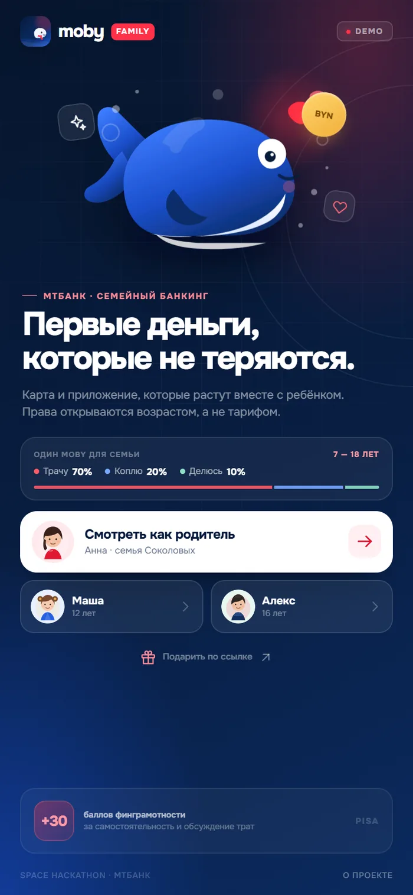
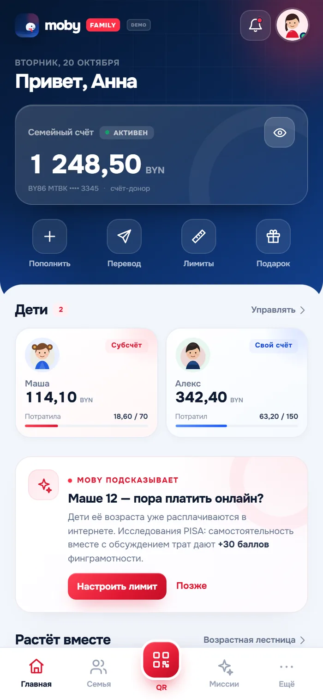
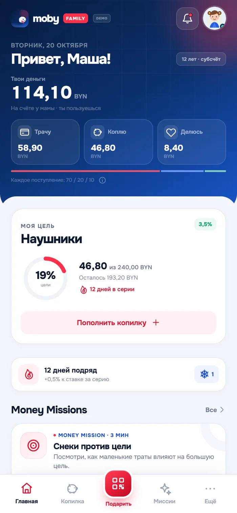
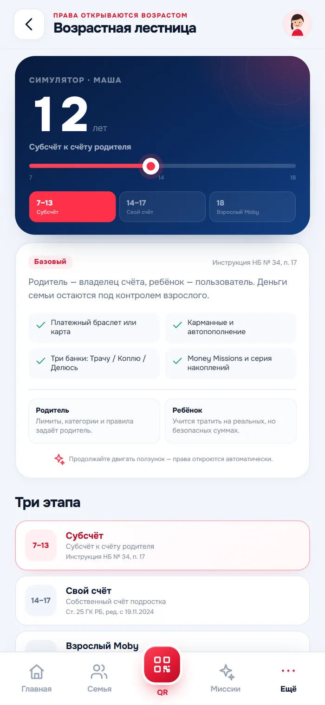
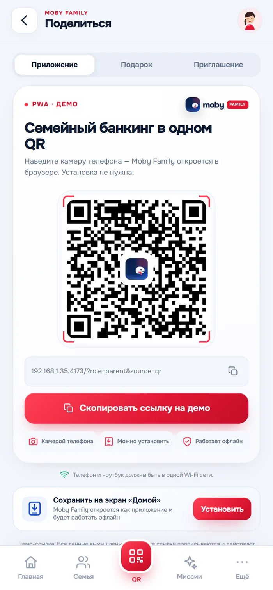
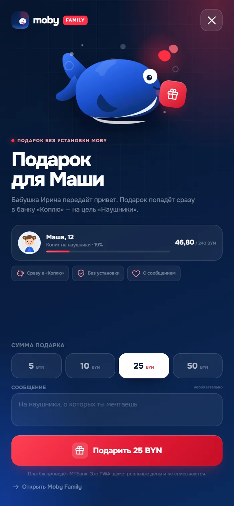

# Moby Family

**Семейный банкинг МТБанка, который растёт вместе с ребёнком с 7 до 18 лет.**
Интерактивное PWA-демо для Space Hackathon: от первого браслета и субсчёта до собственного счёта подростка и автоматического перехода во взрослый Moby.

> «Первые деньги ребёнка, которые не теряются и не исчезают бесследно».


*QR ведёт на опубликованную версию после включения GitHub Pages. Для локального показа используйте QR внутри приложения — он подставит сетевой адрес автоматически.*

---

## Готовый Windows EXE

Для показа и отправки одним файлом:

- **`dist/MobyFamily.exe`** — портативный запуск демо, Node.js не нужен.
- **`dist/MobyFamily-windows-x64.zip`** — то же + инструкция внутри (14,8 МБ).

Запустите `MobyFamily.exe` — откроется браузер с демо. Чёрное окно — это локальный сервер; не закрывайте его, пока идёт показ. Если Windows покажет SmartScreen, нажмите «Подробнее → Выполнить всё равно»: EXE не подписан сертификатом, это нормально для хакатонного прототипа.

Собрать EXE заново:

```bash
npm install
npm run build:exe
```

Первая сборка скачивает runtime Node.js для упаковки. Готовый файл не требует Node.js на компьютере получателя.

---

## Быстрый старт из исходников

Нужен Node.js 18+.

```bash
npm start
```

Откройте **http://localhost:4173/**.

На Windows можно просто запустить `start.bat` — он поднимет сервер и откроет браузер.

В левой части появится интерактивный телефон, справа — QR для запуска на телефоне. QR в самом приложении (вкладка **QR**) генерируется из текущего адреса. Если сервер запущен на ноутбуке, он подставляет IP основного сетевого интерфейса (обычно Wi‑Fi), а не localhost.

### Показать на телефоне по QR

1. Ноутбук и телефон должны быть в **одной Wi‑Fi сети**.
2. Запустите `npm start`.
3. Откройте на ноутбуке http://localhost:4173/ и отсканируйте QR справа.
4. Если Windows спросит про доступ Node.js к сети — разрешите.
5. Если QR не открывается, проверьте адрес из консоли (`Phone: http://…:4173/`) и брандмауэр.

Можно задать публичный адрес вручную:

```powershell
$env:PUBLIC_URL="https://your-demo.example/"
npm start
```

> Локальный HTTP по Wi‑Fi подходит для просмотра демо. Для установки PWA и офлайн-режима нужен HTTPS (GitHub Pages) или localhost на самом устройстве — это ограничение браузеров, а не приложения.

---

## Что умеет демо

| Сценарий | Что показать |
|---|---|
| **Родитель** | Семейный счёт, дети, подсказка Moby, серия накоплений, лимиты |
| **Маша, 9** | Субсчёт, цель «Наушники», серия и родительские правила |
| **Алекс, 16** | Собственный счёт по ст. 25 ГК РБ, карта, правила вместо разрешений |
| **Возрастная лестница** | Интерактивный ползунок 7 → 18 с юридическими переходами |
| **Лимиты** | Недельный лимит, онлайн-покупки, наличные, переводы, PISA-подсказка |
| **QR и подарок** | Демо-ссылка, приглашение ребёнка и подарок от близких без установки Moby |
| **Миссии Moby** | Реальный квиз с данными ребёнка, наградой и серией |
| **Семья** | Роли: владелец, со-родитель, ребёнок, близкие; тариф и условия |

Все имена, балансы и операции вымышлены. Демо работает без бэкенда.

### Как это выглядит

<p align="center">
  
  
  
  
</p>
<p align="center">
  
  
</p>

---

## PWA

- `manifest.webmanifest` — установка, standalone-режим, иконки.
- `service-worker.js` — network-first + офлайн-кэш.
- На HTTPS приложение можно добавить на экран «Домой»; после установки оно открывается без адресной строки.
- Кнопки «Установить» используют `beforeinstallprompt`, а на iOS показывают инструкцию.

### Публикация через GitHub Pages

В репозитории уже есть workflow `.github/workflows/pages.yml`.

1. Отправьте проект в `main`:

   ```bash
   git add .
   git commit -m "Moby Family PWA demo"
   git push origin main
   ```

2. В GitHub откройте **Settings → Pages** и выберите **Source: GitHub Actions**.
3. После сборки демо будет доступно по адресу:

   **https://ivan123burner.github.io/hackathon_mtb/**

4. Если меняется имя пользователя/репозитория, обновите `productionUrl` в `js/config.js` и пересоберите QR:

   ```bash
   npm install
   npm run qr
   ```

Статическая версия не требует Node.js: достаточно `index.html`, `css/`, `js/`, `assets/`, `manifest.webmanifest` и `service-worker.js`.

### Публичная ссылка

Для стабильной публичной ссылки используйте GitHub Pages (выше). Бесплатные туннели вроде localtunnel показывают посетителю страницу с вводом IP-хоста, поэтому для QR на жюри они не подходят.

---

## Три минуты для жюри

1. **Welcome**: покажите, что это не отдельное детское приложение — один Moby для семьи.
2. **Родитель**: подсказка «Маше 9 — пора платить онлайн?» с опорой на PISA. Нажмите «Настроить лимит».
3. **Маша**: цель, серия и родительские правила; запустите короткую миссию про снеки и цель.
4. **Правила**: измените лимит и сохраните — изменения сразу видны в профиле ребёнка.
5. **Возрастная лестница**: проведите ползунок с 9 до 14 и 18; покажите юридические переходы.
6. **QR → Подарок**: откройте сценарий бабушки: подарок без установки приложения.
7. **Семья**: роли, со-родитель, тариф 2,99 BYN и условия бесплатного пакета.

Подробный текст питча — в [PITCH.md](PITCH.md).

---

## Структура

```
index.html              — оболочка, desktop-showcase и смартфон
css/styles.css          — дизайн-система и все экраны
js/app.js               — состояние, роутинг, сценарии, модальные окна
js/data.js              — семья, дети, миссии, транзакции
js/icons.js             — SVG-иконки и аватары
js/qr.js                — генерация QR и ссылки
js/vendor/qrcode.js     — локальная QR-библиотека (MIT)
service-worker.js       — офлайн-кэш
manifest.webmanifest    — PWA
assets/                 — шрифты Onest, иконки, иллюстрация, QR
scripts/server.js       — локальный сервер + автоматический LAN-адрес для QR
scripts/make-icons.js   — генерация PNG-иконок
scripts/make-qr.js      — статический QR для презентации
scripts/test-flows.js   — smoke-тесты сценариев (Playwright)
scripts/screenshots.js  — скриншоты ключевых экранов
dist/                   — собранный портативный EXE и ZIP (не входит в git)
```

Сборка Windows-версии:

```bash
npm run build:exe
```

Результат — `dist/MobyFamily.exe`, standalone-файл для Windows x64. В него упакованы Node.js, сервер и все assets; получателю Node.js не нужен.

---

## Проверка

```bash
npm install
npm test
```

Тесты проверяют переключение ролей, сохранение лимитов, прохождение миссии, подарок, декодирование QR и офлайн-перезагрузку. Используется локальный Chrome; при необходимости задайте `CHROME_PATH`.

```bash
npm run screenshots
```

Скриншоты сохраняются в `shots/` (папка не входит в публикацию).

---

## Юридическая рамка

- **7–13 лет** — субсчёт к счёту родителя, Инструкция НБ № 34, п. 17. Родитель — владелец, ребёнок — пользователь.
- **14–17 лет** — собственный счёт подростка, ст. 25 ГК РБ в редакции с 19.11.2024. Базовые условия без обязательного согласия родителя на каждую операцию; контроль — настраиваемые правила.
- **18 лет** — автоматический переход во взрослый счёт внутри Moby, без визита в банк.

Формулировки в демо упрощены для презентации. Продакшн-версия требует согласования с юридическим департаментом МТБанка.

---

Moby Family · МТБанк × Space Hackathon · демо-прототип.
